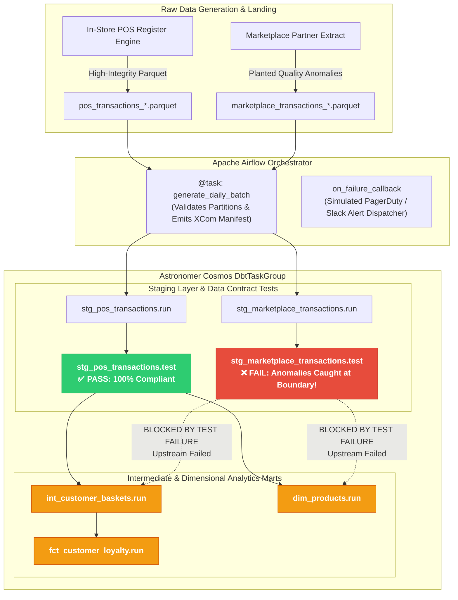
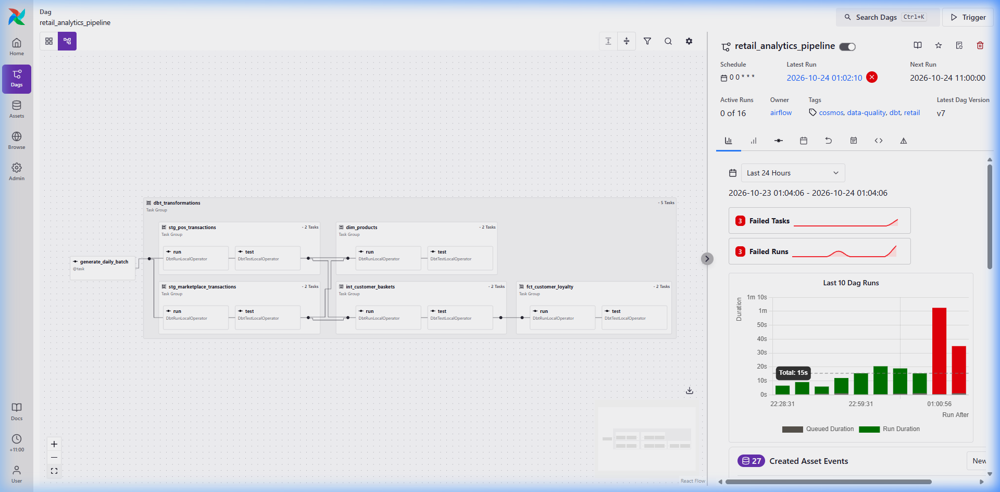
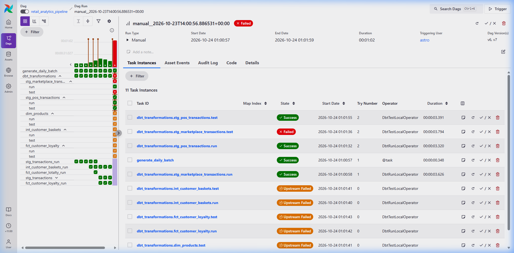

# 🛒 Retail Orchestrator: Enterprise Data Pipeline & Quality Test Isolation

[](https://airflow.apache.org/)
[](https://astronomer.github.io/astronomer-cosmos/)
[](https://www.getdbt.com/)
[](https://duckdb.org/)
[](https://www.python.org/)
[](https://docs.pytest.org/)

> **An enterprise-grade retail data engineering pipeline orchestrating modular dbt transformations via Astronomer Cosmos and Apache Airflow on Astro Runtime. Features multi-source ingestion, automated dbt data quality test gates, granular DAG-level task isolation, concurrency serialization, and downstream reporting protection.**

---

## 📌 Executive Summary

In retail data engineering, pipelines frequently ingest transaction data from heterogeneous channels:
1. **Physical Point-of-Sale (POS) Registers**: Direct, verified in-store feeds conforming strictly to schema standards.
2. **Third-Party Partner Marketplaces**: External, unvetted feeds prone to synchronization glitches, duplicate checkouts, and missing customer identifiers.

Traditional monolithic pipelines execute transformations as opaque, black-box scripts (e.g. a single `dbt run`). When external feeds introduce corrupted records, monolithic architectures either:
- **Silently poison downstream executive dashboards** with corrupt metrics (e.g. erroneous customer lifetime values, negative basket totals).
- **Crash the entire batch run**, failing clean in-store data alongside corrupted partner data with zero lineage visibility.

### The Solution: Modular Orchestration with Astronomer Cosmos
`retail-orchestrator` eliminates monolithic batch execution by dynamically parsing the dbt DAG into granular Apache Airflow task groups using **Astronomer Cosmos**. By enforcing `RenderConfig(test_behavior=TestBehavior.AFTER_EACH)`, each dbt model is accompanied by its corresponding data contract tests. When the unvetted marketplace feed violates quality thresholds, the pipeline isolates and halts the faulty branch at the staging boundary—guaranteeing that corrupted records never pollute downstream customer loyalty marts (`fct_customer_loyalty`, `dim_products`).

---

## 🏛️ Pipeline Architecture



---

## 📸 Real-World Evidence: Airflow UI in Action

### 1. Airflow DAG Topology (Graph View)
Astronomer Cosmos dynamically decomposes the dbt project into modular Airflow TaskGroups with discrete `run` and `test` nodes.



### 2. Live Quality Test Isolation (Grid View)
In the live execution below, the Airflow orchestrator caught planted anomalies in the third-party marketplace feed. Notice how:
- `generate_daily_batch` succeeded and emitted an audit manifest.
- `stg_pos_transactions` (`run` & `test`) passed **100% green**.
- `stg_marketplace_transactions.test` **failed immediately (red)** upon detecting duplicate transaction IDs and null customer IDs.
- Downstream marts (`int_customer_baskets`, `fct_customer_loyalty`, `dim_products`) transition to **`upstream_failed` (orange)**, successfully isolating the dirty data and protecting reporting integrity.



---

## 🔍 Deep-Dive: Enterprise Features Implemented

### 1. Modern Apache Airflow & TaskFlow API
- **TaskFlow Decorators (`@dag`, `@task`)**: Modern functional task definitions with clean typed signatures.
- **XCom Manifest Passing**: The ingestion task outputs a structured JSON batch manifest (partition timestamps, row counts, and file manifests) accessible to downstream tasks.
- **Data-Aware Scheduling (`Asset` / `Dataset`)**: Emits dataset updates (`duckdb://include/data/retail.duckdb`) enabling event-driven triggering of consumer DAGs.
- **Enterprise Failure Callbacks (`on_failure_callback`)**: Dispatches automated alert payloads with DAG ID, task instance, execution date, and direct log URL links for incident response.
- **Embedded Markdown Documentation (`dag.doc_md`)**: Rich architectural documentation rendered natively inside the Airflow UI's "DAG Docs" tab.

### 2. dbt Core Dimensional Architecture & Data Contracts
- **Layered Modeling**:
  - `staging/`: `stg_pos_transactions.sql` and `stg_marketplace_transactions.sql` standardize data types, parse timestamps, and tag origin channels (`POS` vs `MARKETPLACE`).
  - `intermediate/`: `int_customer_baskets.sql` computes basket-level metrics (units, spend, category diversity).
  - `marts/`:
    - `fct_customer_loyalty.sql`: Computes customer lifetime value (LTV), transaction frequency, and loyalty tier segmentation (`Platinum`, `Gold`, `Silver`, `Bronze`).
    - `dim_products.sql`: Product dimension table with category classifications and price statistics.
- **Data Quality Contracts**:
  - Schema tests in `schema.yml`: `not_null`, `unique`, and `accepted_values` on categories (`['Snacks', 'Dairy', 'Produce', 'Beverages', 'Bakery']`).
  - Singular test `tests/assert_positive_basket_spend.sql`: Asserts that no customer checkout has negative or zero basket spend.

### 3. Astronomer Cosmos & Astro Runtime
- **Task Isolation via `RenderConfig`**: Configured with `TestBehavior.AFTER_EACH` so that test tasks run directly after their model, creating discrete test gates in the DAG.
- **DuckDB Concurrency Control**: DuckDB is an in-process analytical engine allowing only a single active writer. To eliminate database file lock contention in Airflow's multi-threaded `LocalExecutor`, a dedicated Airflow pool (`dbt_pool` with `pool_slot: 1`) was configured in `airflow_settings.yaml` and bound to the DAG's `default_args`.
- **Dual Execution Compatibility**: `profiles.yml` and `sources.yml` leverage `{{ env_var(...) }}` fallbacks, allowing seamless execution both inside containerized Linux environments (`/usr/local/airflow/...`) and on local developer workstations.

---

## 📂 Project Directory Structure

```text
retail-orchestrator/
├── dags/
│   ├── .airflowignore
│   └── retail_analytics_dag.py        # Modern TaskFlow DAG with Cosmos DbtTaskGroup & failure alerting
├── docs/
│   ├── images/
│   │   ├── airflow_graph_view.png     # Airflow UI Graph View screenshot
│   │   └── airflow_grid_view.png      # Airflow UI Grid View showing caught test failure
│   └── superpowers/
│       ├── plans/                     # Implementation plans
│       └── specs/                     # Architecture & design specifications
├── include/
│   ├── data/
│   │   ├── raw/                       # Daily partitioned POS & Marketplace Parquet extracts
│   │   └── retail.duckdb              # Analytical DuckDB database instance
│   ├── dbt_retail/                    # Modular dbt transformation project
│   │   ├── dbt_project.yml            # dbt project configuration & test paths
│   │   ├── profiles.yml               # DuckDB connection profile with env_var support
│   │   ├── models/
│   │   │   ├── staging/               # Sources, staging views, and schema data contracts
│   │   │   │   ├── sources.yml
│   │   │   │   ├── schema.yml
│   │   │   │   ├── stg_pos_transactions.sql
│   │   │   │   └── stg_marketplace_transactions.sql
│   │   │   ├── intermediate/          # Bounded basket aggregation models
│   │   │   │   └── int_customer_baskets.sql
│   │   │   └── marts/                 # Dimensional facts and product dimensions
│   │   │       ├── schema.yml
│   │   │       ├── fct_customer_loyalty.sql
│   │   │       └── dim_products.sql
│   │   └── tests/                     # Singular business logic test suite
│   │       └── assert_positive_basket_spend.sql
│   └── scripts/
│       ├── generate_mock_fmcg.py      # Multi-source mock generator with planted data quality flaws
│       └── read_parquet.py            # Local inspection script
├── tests/
│   ├── dags/
│   │   └── test_dag_integrity.py      # Automated CI test suite for DAG syntax & structure
│   └── test_mock_generator.py         # Unit tests validating mock generator quality anomalies
├── airflow_settings.yaml              # Local Astro configuration (DuckDB connection, pools, variables)
├── Dockerfile                         # Astro Runtime container specification
├── requirements.txt                   # Astro Python package dependencies
└── README.md                          # Production portfolio showcase
```

---

## 🚀 Quickstart & Local Reproduction

### Prerequisites
- [Docker Desktop](https://www.docker.com/products/docker-desktop/) (v20.10+)
- [Astro CLI](https://www.astronomer.io/docs/astro/cli/install-cli) (v1.40+)
- Python 3.11+ (for local CLI test execution)

### 1. Clone the Repository
```bash
git clone https://github.com/somerandomguy-coder/retail-orchestrator.git
cd retail-orchestrator
```

### 2. Start the Local Airflow Environment
```bash
astro dev start
```
*Astro CLI will build the local image, initialize Postgres, apply Airflow migrations, and import `airflow_settings.yaml` (connections, pools, and variables).*

### 3. Access the Airflow UI
- Open your browser to: **`http://localhost:8080`**
- Default credentials: `admin` / `admin`
- Select DAG: **`retail_analytics_pipeline`**

### 4. Trigger the Pipeline & Observe Test Isolation
```bash
astro dev run dags trigger retail_analytics_pipeline
```
- Open the **Graph View** or **Grid View** in the Airflow UI.
- Observe:
  1. `generate_daily_batch` runs and succeeds.
  2. `stg_pos_transactions.run` and its tests turn **green**.
  3. `stg_marketplace_transactions.test` fails with **red**, catching the duplicate transaction keys and null customer IDs.
  4. Downstream marts are marked **`upstream_failed`**, protecting the analytical warehouse from dirty data.

### 5. Run the Automated Test Suite Locally
```bash
# Set up local virtual environment
python -m venv .venv
source .venv/bin/activate  # On Windows: .venv\Scripts\activate
pip install -r requirements.txt pytest

# Run automated CI tests
pytest tests/ -v
```

---

## 💡 Engineering Insights & Best Practices

1. **DuckDB Concurrency in Multi-Threaded Airflow**:
   DuckDB is optimized for lightning-fast vectorized queries on columnar data, but enforces single-writer locking. In Airflow's `LocalExecutor`, concurrent tasks targeting the same DuckDB file will trigger `IO Error: Could not set lock on file`. By creating a dedicated `dbt_pool` with `pool_slot: 1` in `airflow_settings.yaml`, dbt tasks are serialized automatically, eliminating lock contention without reducing DAG readability.

2. **Cosmos Granular Test Mapping (`TestBehavior.AFTER_EACH`)**:
   Standard dbt deployments often run `dbt build` or batch `dbt test` at the end of the pipeline. If a test fails after all marts have already materialized, the corrupted data has already entered production. By configuring `AFTER_EACH` in Cosmos, tests run immediately after staging views are created, acting as an immutable quality circuit breaker.

3. **Multi-Platform Path Portability**:
   Paths differ between local developer host OSes (e.g. Windows drive letters) and Linux container environments (`/usr/local/airflow`). By leveraging Jinja `{{ env_var('KEY', 'default_path') }}` in dbt profiles and sources, the codebase runs identically in Astro Docker containers and local developer virtualenvs.

---

## 📜 License
This project is licensed under the MIT License. See [LICENSE](LICENSE) for details.
