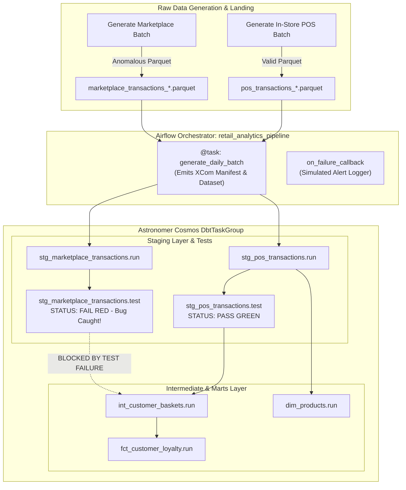

# Retail Orchestrator: Enterprise Pipeline & Test Isolation Design

- **Date**: 2026-10-24
- **Project**: Retail Orchestrator
- **Status**: Approved

---

## 1. Executive Summary & Goals

### 1.1 Context
Retail data engineering pipelines routinely suffer from silent data corruption when external sources (e.g. 3rd-party marketplace feeds, partner APIs, or legacy databases) introduce malformed, null, or out-of-range records. Traditional monolithic pipelines either fail opaque batch jobs with no lineage visibility or ingest corrupted records directly into production analytics marts.

### 1.2 Objective
Transform `retail-orchestrator` from a basic practice script into an enterprise-grade showcase demonstrating:
1. **Multi-Source Ingestion**: Ingesting high-integrity in-store POS data alongside inherently dirty, unvetted 3rd-party marketplace data.
2. **Astronomer Cosmos DAG-Level Isolation**: Decomposing dbt models and tests into granular Airflow tasks so that data quality test failures are caught visually in the Airflow Graph View (`test_behavior=TestBehavior.AFTER_EACH`).
3. **Downstream Mart Protection**: Demonstrating that failed data quality contracts halt downstream dimensional marts (`int_customer_baskets`, `fct_customer_loyalty`, `dim_products`), isolating errors at the staging boundary.
4. **Deep Tool Leveraging**: Fully utilizing Apache Airflow (TaskFlow API, metadata XComs, failure callbacks, DAG docs, SLAs, Dataset triggers), dbt-core (sources, staging, intermediate, dimensional marts, schema tests, singular business rules), and Astro CLI (managed runtime, connections, pools, variables, pytest suite).
5. **Real-world Documentation & Evidence**: Capturing live screenshots of the Airflow UI Graph View (green POS vs. caught red marketplace test failure) via browser automation and publishing an executive-ready `README.md`.

---

## 2. Architecture & Data Flow

---

## 3. Detailed Component Specifications

### 3.1 Mock Data Generation (`include/scripts/generate_mock_fmcg.py`)
Generates raw daily parquet files in `include/data/raw/`:
- **POS Store Transactions** (`pos_transactions_{date}.parquet`):
  - Rows: ~3,000 clean records per day.
  - Fields: `transaction_id`, `customer_id`, `basket_id`, `transaction_timestamp`, `product_id`, `product_category`, `quantity` (1 to 5), `unit_price` ($1.50 to $25.00).
  - Validation: 100% compliant with schema tests.
- **Marketplace Partner Transactions** (`marketplace_transactions_{date}.parquet`):
  - Rows: ~1,500 records per day.
  - Injected Realistic Data Quality Flaws:
    - **Null Customer IDs**: ~5% of records have `NULL` due to unauthenticated guest checkouts.
    - **Duplicate Transaction IDs**: Retry collisions generating repeated primary keys.
    - **Negative / Zero Unit Prices**: Corrupted refund syncs generating negative prices ($ -15.00).

### 3.2 dbt Layer (`include/dbt_retail`)
1. **Sources (`models/staging/sources.yml`)**:
   - `landing.pos_transactions`: external location `/usr/local/airflow/include/data/raw/pos_transactions_*.parquet`.
   - `landing.marketplace_transactions`: external location `/usr/local/airflow/include/data/raw/marketplace_transactions_*.parquet`.
2. **Staging Models**:
   - `models/staging/stg_pos_transactions.sql`: Type casting, column renaming, channel tag `'POS'`.
   - `models/staging/stg_marketplace_transactions.sql`: Type casting, column renaming, channel tag `'MARKETPLACE'`.
3. **Data Quality Tests (`models/staging/schema.yml` & `tests/`)**:
   - `transaction_id`: `not_null`, `unique`
   - `customer_id`: `not_null` (will catch marketplace nulls!)
   - `quantity`: accepted values or positive constraint
   - `product_category`: `accepted_values` (`['Snacks', 'Dairy', 'Produce', 'Beverages', 'Bakery']`)
   - `tests/assert_positive_basket_spend.sql`: Singular test ensuring no basket has spend <= 0.
4. **Intermediate & Dimensional Marts**:
   - `models/intermediate/int_customer_baskets.sql`: Unions staging sources (or downstream consumer), calculates basket metrics (`basket_spend`, `total_units`, `distinct_categories_count`).
   - `models/marts/fct_customer_loyalty.sql`: Computes lifetime spend, total baskets, and customer loyalty tiers (`Bronze`, `Silver`, `Gold`, `Platinum`).
   - `models/marts/dim_products.sql`: Product dimension table with categories and avg pricing metrics.

### 3.3 Apache Airflow & Astronomer Cosmos Orchestration (`dags/retail_analytics_dag.py`)
1. **Airflow Best Practices**:
   - Remove unused standard library `import profile`.
   - Modern TaskFlow `@dag` with `catchup=False`, `tags=["retail", "dbt", "cosmos", "data-quality"]`.
   - Rich documentation embedded in `dag.doc_md` rendered in the Airflow UI DAG Docs tab.
   - `on_failure_callback`: Logs alert payload with DAG ID, task instance, execution date, and log URL.
   - `@task def generate_daily_batch()`: Verifies raw parquet generation and returns an XCom manifest dict.
   - Outlets: Publishes `Dataset("duckdb://include/data/retail.duckdb")`.
2. **Astronomer Cosmos Configuration**:
   - `RenderConfig(test_behavior=TestBehavior.AFTER_EACH)`: Maps dbt tests to discrete Airflow tasks immediately following each model.
   - `ProfileConfig` with `DuckDBUserPasswordProfileMapping` bound to Airflow connection `duckdb_default`.
   - `ExecutionConfig` with `/usr/local/bin/dbt`.

### 3.4 Astro Runtime & Environment Configuration
1. **`airflow_settings.yaml`**: Pre-populates:
   - Connection `duckdb_default` (`duckdb` connection type).
   - Variables: `retail_raw_dir`, `notification_channel`.
   - Pools: `dbt_pool` (slots: 4).
2. **`.env`**: Sets `AIRFLOW__CORE__LOAD_EXAMPLES=False`, `AIRFLOW__CORE__DAGS_ARE_PAUSED_AT_CREATION=False`.
3. **`tests/dags/test_dag_integrity.py`**: Pytest suite testing:
   - DAG import without syntax errors or broken DAG errors.
   - DAG properties (id, tags, tasks existence).
   - Acyclic graph integrity.

### 3.5 Verification & Browser Automation
1. Local execution of data generator and DAG validation via pytest.
2. Spin up/verify Astro environment (`astro dev start`).
3. Trigger DAG run in Airflow.
4. Dispatch `browser_subagent` to navigate to `http://localhost:8080`, view the DAG graph view, inspect the passed and failed tasks, and capture screenshots.
5. Save screenshots into `docs/images/`.

### 3.6 Professional Portfolio README
Transform README.md to include:
- Badges (Astro, Airflow, dbt, DuckDB, Python, pytest).
- Project Overview & Real-World Business Context.
- Architecture Diagram (Mermaid).
- The Problem: Silent corruption from dirty 3rd-party data feeds.
- The Solution: Granular test isolation with Astronomer Cosmos.
- Embedded Airflow Graph View Screenshot with visual callouts explaining the caught bug.
- Step-by-Step Local Replication Guide.
- Test Suite & Code Quality.

---

## 4. Git Checkpoints
Every phase of implementation will be accompanied by:
- `git add <files>`
- `git commit -m "<descriptive message>"`
- `git push origin main`
